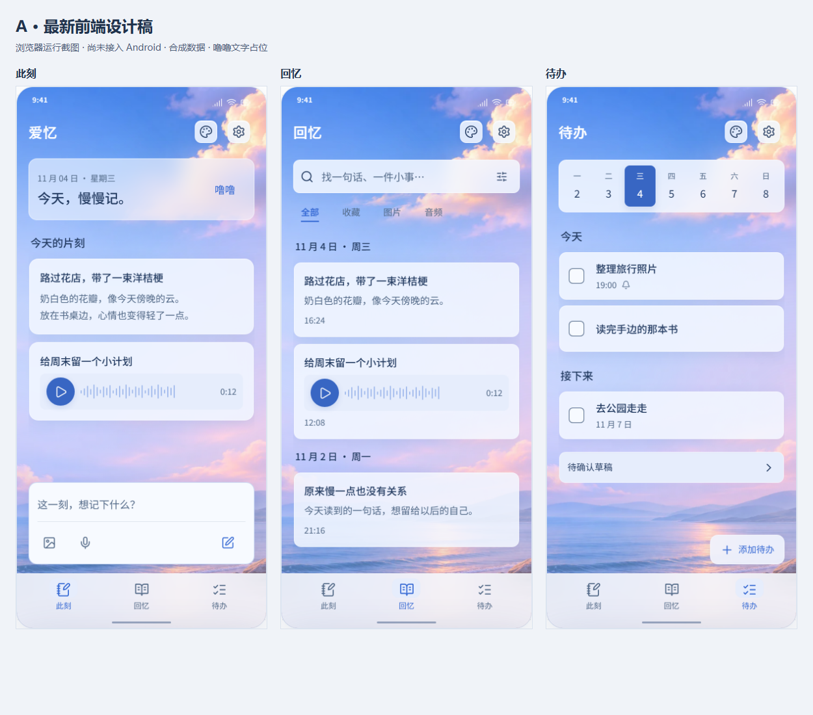
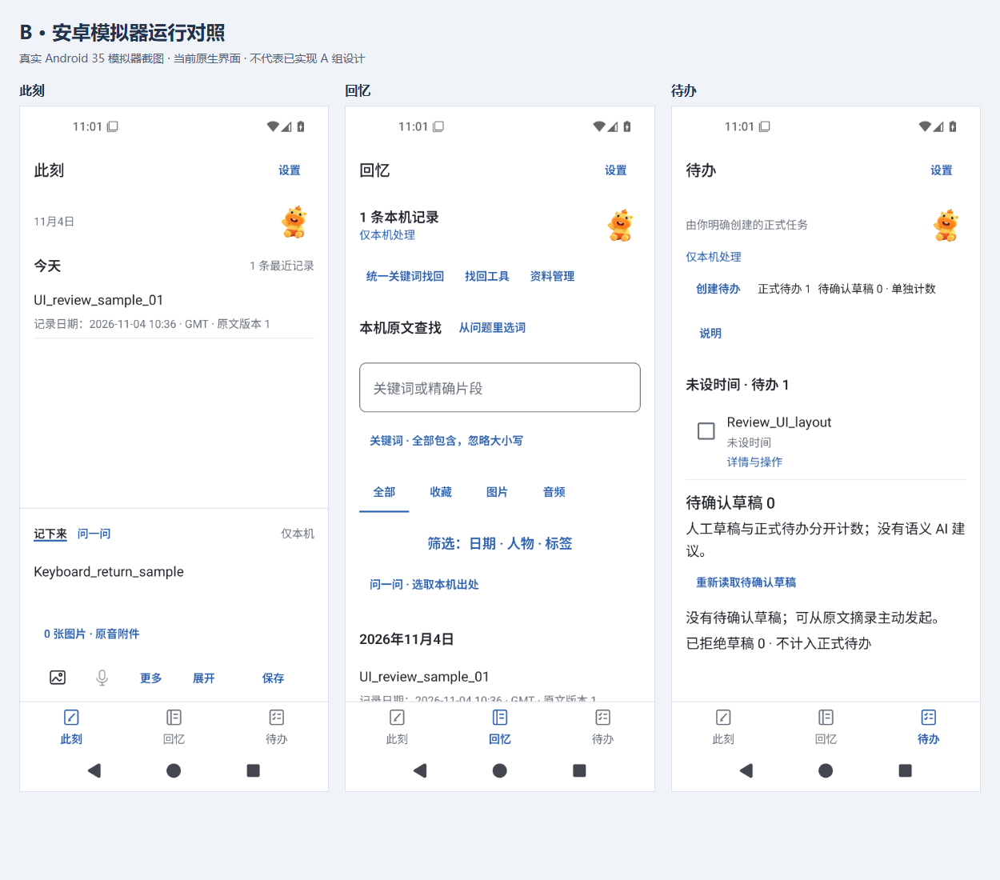

# AIyou 前端审阅图包

本图包用于评审 AIyou（爱忆）的移动端视觉与交互。请先看 **A 组新版设计稿**，B 组仅用于了解现有 Android 实现与迁移差距。

**两组图片不可混用：** A 是当前设计代码在浏览器中的实际运行截图，尚未接入 Android APK；B 是此前保留并核验哈希的真实 Android 35 模拟器截图，本次没有重新启动模拟器。两组均使用合成数据。公开版设计稿中的噜噜使用文字占位，不上传用户的原始参考截图，不代表角色最终美术。

- 设计源码基线：`3f3c7c8cf0ea5f2c9116730b2a85948daec924c1`。
- Android 对照基线：`3c38b0e4dc1149cd244d1c722d66813ca3da2f91`；已核对相关 `app/src/main` 文件与存档源码哈希一致。
- A 组普通画面为 390 × 844 CSS px，PNG 按 2 倍像素输出；窄屏为 320 × 844 CSS px。B 组为 1080 × 2400 像素、480 dpi，名义 360 × 800 dp，包含系统栏。
- 单张 PNG 保持截图原始字节。概览图仅把三张原图排在一起并加组别标题；它不是新的 App 屏幕。
- 静态截图不能证明动效流畅、真机输入法、TalkBack、通知送达或性能已经验收。

## A 组：本轮前端主要审阅对象

| 图片 | 内容与审阅重点 |
| --- | --- |
| [01 此刻 · 晴空](prototype/01-now-blue.png) | 紧凑欢迎区、记录与底部输入区的主次；不再常驻无用数量标签 |
| [02 回忆 · 晴空](prototype/02-memories-blue.png) | 搜索前置、筛选、共享日期分组、音频条目 |
| [03 待办 · 晴空](prototype/03-tasks-blue.png) | 日期选择、任务行、提醒与待确认入口、稳定的新增按钮 |
| [04 此刻 · 晚霞](prototype/04-now-sunset.png) | 暖色背景与玻璃表面、文字、操作色的协调 |
| [05 此刻 · 星夜](prototype/05-now-night.png) | 深色玻璃和浅色文字，不只是换壁纸 |
| [06 回忆 · 星夜](prototype/06-memories-night.png) | 深色搜索、列表与日期分组 |
| [07 待办 · 星夜](prototype/07-tasks-night.png) | 深色日历、完成控件与待确认入口 |
| [08 外观选择](prototype/08-appearance-picker.png) | 三套应用主题；静态、轻柔移动、流光；减少动态 |
| [09 记录编辑](prototype/09-record-editor.png) | 编辑面板、正文与提交按钮。此图没有 Android 系统键盘 |
| [10 回忆筛选](prototype/10-memory-filters.png) | 筛选面板的布局与返回入口，部分选项仍为展示占位 |
| [11 新增待办](prototype/11-task-editor.png) | 标题输入、日期表达和确认按钮 |
| [12 此刻 · 320px 窄屏](prototype/12-now-narrow-320.png) | 窄屏适应，不等于 Android 大字体验收 |

## B 组：现有 Android 运行对照

| 图片 | 证据范围 |
| --- | --- |
| [01 此刻](android/01-now.png) | 原生 App 中的记录、草稿、附件入口和底栏 |
| [02 回忆](android/02-memories.png) | 原生查找工具与真实合成记录 |
| [03 待办](android/03-tasks.png) | 原生任务创建后的列表 |
| [04 原音播放中](android/04-audio-playing.png) | 合成 PCM 文件通过系统文件选择器导入后的实际播放状态 |
| [05 系统键盘](android/05-keyboard.png) | 模拟器默认输入法与合成英文输入；不代表真机中文组合输入验证 |
| [06 备份首页](android/06-backup-home.png) | 只读查看入口和恢复条件；没有执行完整备份恢复验收 |

音频与键盘图来自同轮稍早的验证，未单独绑定精确 APK 哈希。主页面及备份交付图的 APK 绑定、所有图片 SHA-256 见 [manifest.json](manifest.json) 与 [android/capture.json](android/capture.json)。

## 项目与本阶段修改

AIyou 是安卓原生、中文优先、本地优先的私人记录工具。产品围绕「此刻记录 → 回忆查找 → 用户确认后的待办提醒」组织，并有水豚噜噜陪伴。记录、原始附件、派生内容和正式任务应保持语义清楚，不能用美化的状态文案冒充保存、发送或调度成功。真实模型、OCR、ASR 等能力不应仅凭设计稿判断为可用。

本阶段的设计改动包括：

1. 使用自然景观位图背景，去掉玻璃底座、摆件、装饰气泡；磨砂质感只放在 UI 层。
2. 提供晴空蓝、桃色晚霞、星夜紫三套主题，协调文字、玻璃表面、导航与按钮颜色。
3. 三页使用不同结构：此刻保留小欢迎区与停靠输入区；回忆优先搜索与日期分组；待办优先日期和任务。
4. 清除孤立数量、重复格式说明和默认状态解释，保留时刻、提醒状态、筛选分类与确认边界。
5. 统一中文字体层级与线性图标，缩小底栏选中底形，区分编辑、展开和提交操作。
6. 实现可点击的设计演示：局部按压反馈、导航选中态移动、页面轻过渡、面板拖动关闭、焦点返回、空输入禁用、演示记录／任务、搜索与筛选组合。
7. 背景支持静态、轻柔移动和流光；减少动态、后台及输入／滚动时降低或暂停装饰运动。

这些是**设计原型的实现和检查结果**。设计尚未整体移植到 Kotlin/Compose。此前原生阶段已修复工具条拥挤、音频面板停止入口、旧保存提示残留等问题，但其验收不能替代新设计的 Android 验收。

## 希望获得的进一步建议

- 三页的信息主次与首屏内容是否清楚，是否仍有无用小字、过大的空白或重复容器。
- 中文字体、字号、字重、行高与图标是否统一、精致，是否存在局部孤行和视觉失衡。
- 三套主题中的玻璃环境透色、描边、阴影、文字对比和主要操作强调是否协调。
- 按钮、播放器、日期选择、任务完成、筛选和返回的角色是否明确，哪里还像开发表单或模板。
- 动态应如何进一步打磨：动效建议与截图观察分开表述，不从静态图片推断实际帧率、触区或手感。
- 噜噜最终应怎样融入内容而不抢占功能空间；此图包没有用于审核角色造型的正式美术。

请聚焦前端，不扩展后端架构，也不要靠增加功能和说明文字填满界面。自然景观、玻璃质感、可选主题和适度动态是已认可的方向。

## 代码和复查入口

- [可直接复制的 GPT 审阅提示词](GPT_REVIEW_PROMPT.md)
- [页面结构](../../../design/prototypes/skyglass-pages.js)
- [布局与过渡](../../../design/prototypes/skyglass-layout.css)
- [玻璃样式与基础动效](../../../design/prototypes/skyglass.css)
- [主题样式](../../../design/prototypes/skyglass-themes.css) / [主题交互](../../../design/prototypes/skyglass-themes.js)
- [设计检查记录](../../../design/prototypes/skyglass-layout-review.json)
- [原生检查记录](../../evidence/windows-android-ui-review-20261104.json)
- [设计构建器](../../../scripts/build-skyglass-prototype.cjs) / [截图脚本](../../../scripts/capture-ui-review.cjs)

图包没有改动 App 逻辑，因此本次不重新执行 Android 编译或设备测试。A 组从当前设计代码重新截取，浏览器控制台无脚本错误；B 组逐张核验了存档哈希。
